  

  

---

<table width="100%">
  <tr>
    <td width="60%" valign="top">
      <h3>🚀 About Me</h3>
      <ul>
        <li>🔭 I’m currently working on <strong>cross-platform apps with Flutter</strong></li>
        <li>🌱 I’m learning <strong>Advanced Firebase, State Management, and Clean Architecture</strong></li>
        <li>💬 Ask me about <strong>Flutter, Firebase, Frontend Development</strong></li>
        <li>⚡ Fun fact: <em>I love building clean, fast, and scalable apps</em></li>
        <li>📫 Reach me at: <strong>hayatflutter@gmail.com</strong></li>
      </ul>
    </td>
    <td width="40%" valign="top">
      <h3>🌐 Connect With Me</h3>
      

        
          
        
          
        
      

    </td>
  </tr>
</table>

---

<h3 align="center">🛠️ Tech Stack & Tools</h3>

<table align="center" width="100%">
  <tr>
    <td width="33%" align="center" valign="top">
      <h4>📱 Mobile & Frontend</h4>
      
    </td>
    <td width="33%" align="center" valign="top">
      <h4>⚙️ Backend & Services</h4>
      
    </td>
    <td width="33%" align="center" valign="top">
      <h4>🔧 Tools & Platforms</h4>
      
    </td>
  </tr>
</table>

---

<h3 align="center">📊 GitHub Statistics</h3>

  <table align="center">
    <tr>
      <td align="center" valign="middle">
        
      </td>
      <td align="center" valign="middle">
        
      </td>
    </tr>
    <tr>
      <td colspan="2" align="center" valign="middle">
        
      </td>
    </tr>
  </table>

